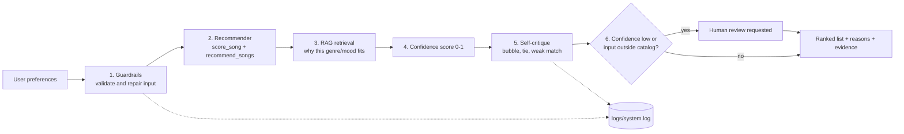

# 🎵 Music Recommender Simulation

## Project Summary

In this project you will build and explain a small music recommender system.

Your goal is to:

- Represent songs and a user "taste profile" as data
- Design a scoring rule that turns that data into recommendations
- Evaluate what your system gets right and wrong
- Reflect on how this mirrors real world AI recommenders

This is a content-based music recommender. It scores every song in a small CSV catalog against a user's favorite genre, mood, and target energy, then ranks the songs and explains each recommendation with the points behind it. It runs from the command line
---

## How The System Works


Platforms like Spotify and YouTube mix two approaches. Collaborative filtering uses other users' behavior (likes, skips, playlists) to find songs that people with similar taste enjoyed. Content-based filtering uses song attributes (genre, mood, energy, tempo) to find songs similar to what you already like. My version is content-based, since I only have a song catalog and one user profile

**Song features:** genre, mood, energy (0.0 to 1.0), tempo_bpm

**UserProfile features:** genre, mood, energy

**Algorithm Recipe (scoring one song):**
- +2.0 points if the song's genre matches the user's favorite genre
- +1.0 point if the song's mood matches the user's favorite mood
- Energy similarity: `1.0 - abs(song_energy - target_energy)`, so songs closer to the target earn more points (max 1.0)

**Ranking rule:** Score every song in the CSV, sort from highest to lowest, and return the top K.

**Expected biases:** Genre is worth the most points, so the system may over-prioritize genre and bury great songs that match the user's mood and energy but have a different genre. It can also create a filter bubble by recommending the same kind of song over and over.


## Algorithm Summary
The recommender is content-based. It scores every song in the catalog
against the user's taste profile. A genre match adds 2.0 points, a mood
match adds 1.0 point, and energy adds up to 1.0 point depending on how
close the song's energy is to the user's target (closer = more points).
Each song ends up with a total score and a list of reasons explaining
where the points came from. Songs are then sorted from highest to
lowest score, and the top 5 are shown to the user.

---

## Getting Started

### Setup

1. Create a virtual environment (optional but recommended):

   ```bash
   python -m venv .venv
   source .venv/bin/activate      # Mac or Linux
   .venv\Scripts\activate         # Windows

2. Install dependencies

```bash
pip install -r requirements.txt
```

3. Run the app:

```bash
python -m src.main
```

### Running Tests

Run the starter tests with:

```bash
pytest
```

You can add more tests in `tests/test_recommender.py`.

---

## Sample Recommendation Output

```
Loaded songs: 10

Top recommendations:

1. Sunrise City
   Score: 3.98
   Reasons:
     - genre match (+2.0)
     - mood match (+1.0)
     - energy closeness (+0.98)

2. Gym Hero
   Score: 2.87
   Reasons:
     - genre match (+2.0)
     - energy closeness (+0.87)

3. Rooftop Lights
   Score: 1.96
   Reasons:
     - mood match (+1.0)
     - energy closeness (+0.96)

4. Night Drive Loop
   Score: 0.95
   Reasons:
     - energy closeness (+0.95)

5. Storm Runner
   Score: 0.89
   Reasons:
     - energy closeness (+0.89)
```

---

## Experiments You Tried

- **Five test profiles.** I ran the recommender for five listeners: High-Energy Pop, Chill Lofi, Deep Intense Rock, Conflicted (pop, sad, energy 0.9), and Unknown Genre (k-pop). The last two were designed to trick the scoring.
- **Weight shift.** I halved the genre points (+2.0 to +1.0) and doubled the energy points (up to +2.0). The top 5 stayed exactly the same for every profile. Only the scores changed, and the gaps between songs got smaller. This happened because genre and energy line up in such a tiny catalog: the pop songs are energetic and the lofi songs are calm. I kept the original weights.
- **Honesty checks.** I added a warning when a user's genre or mood isn't in the catalog at all. I also added a "Weak match" label for songs that only matched on energy.

---

## Limitations and Risks

- The catalog has only 10 songs, and only one of them is rock.
- Genre must match exactly, so "indie pop" never counts as "pop".
- Every song earns some energy points, so the top 5 is always full, even when most picks are weak matches.
- It ignores lyrics, language, artist, and listening history.

---

## Reflection

This project showed me that a recommender turns data into a prediction by adding up points. Each song's score is just its genre points, plus its mood points, plus how close its energy is to what the user wants. The highest totals become the recommendations. Showing the reasons next to each song made this easy to see, because every point can be traced back to where it came from.

It also showed me where bias can sneak in. Genre is worth the most points, so a song in the "right" genre can beat a better-fitting song from a different genre. That can favor popular genres and bury good songs from others. A tiny catalog makes this worse: with only one rock song, a rock fan mostly gets songs that just happen to have the right energy. For more detail, see the [Model Card](model_card.md).
---

# Applied AI System: Trustworthy Music Recommender

**Base project:** *Music Recommender Simulation* (Modules 1-3). The original project scored each song in a
small catalog using a rule-based formula (genre match, mood match, and closeness to a target energy) and
returned a ranked top-k list with a plain-language reason for every score. It was a transparent
recommender, but it returned a confident answer even for bad or unusual input.

## Summary

This version wraps that recommender in a pipeline that decides **when its own answer can be trusted**. It
validates input, uses retrieved knowledge to check whether a request makes sense, scores its own
confidence, critiques its own results, and asks for human review when confidence is low. It matters because
a recommender that sounds equally sure about a good profile and a nonsensical one is hard to rely on.

## Architecture overview

Source diagram: [`diagrams/architecture.mmd`](diagrams/architecture.mmd)



Data flows left to right. A human is involved at step 6: low-trust answers are flagged for review instead of
being presented as confident. Testing is involved through `tests/test_reliability.py` and `src/evaluate.py`.

| Component | File | What it does |
|---|---|---|
| Orchestration | `src/applied_system.py` | Runs the steps in order and returns one `Report` |
| Guardrails | `src/guardrails.py` | Clamps energy to 0-1, flags unknown genre/mood, bounds `k`, rejects an empty catalog |
| RAG | `src/rag.py` | Retrieves notes from a small knowledge base; the retrieved energy range **drives a decision** |
| Confidence | `compute_confidence` | 70% strength of top score + 30% gap between #1 and #2, minus 0.1 per warning |
| Self-critique | `self_critique` | Flags filter bubble, weak match, tie, repeated artist, out-of-catalog, implausible request |
| Human-in-the-loop | `Report.needs_human_review` | True when confidence is under 0.5 or a serious flag is raised |
| Logging | `logs/system.log` | Every run recorded; low-trust runs logged as WARNING |

### How RAG changes behavior (not just printed text)

The knowledge base stores a typical energy range per genre (for example ambient: 0.00-0.40). When a user
asks for a genre, the system retrieves that entry and compares the requested energy to the range.
A mismatch adds a warning, lowers confidence, raises the `implausible_request` flag, and triggers human
review. Retrieved notes are also attached to each recommendation as evidence.

**Before/after (profile: ambient, chill, target energy 1.0):**

| Version | Confidence | Human review | Why |
|---|---|---|---|
| Retrieval only displayed as text | 0.87 | No | The score formula saw a good genre and mood match and trusted it |
| Retrieval drives a decision | 0.77 | **Yes** | Retrieved note says ambient is typically 0.00-0.40, so 1.0 is flagged |

## Setup instructions

```bash
git clone https://github.com/amberdemir/applied-ai-system-final.git
cd applied-ai-system-final
python3 -m venv .venv
source .venv/bin/activate            # Windows PowerShell: .\.venv\Scripts\Activate.ps1
python -m pip install --upgrade pip
pip install -r requirements.txt      # must include pytest
```

Run:

```bash
python -m src.applied_system                               # end-to-end demo, 4 profiles
python -m src.evaluate                                     # reliability experiment table
python -m pytest                                           # 18 tests
python -m src.evaluate > assets/evaluation_output.txt      # save evidence as a text log
```

## Sample interactions

### 1. Typical profile (pop, happy, energy 0.8)

```
$ python -m src.applied_system
=== Pop fan ===
1. Sunrise City by Neon Echo  [pop/happy]  score 3.98
     - genre match (+2.0)
     - mood match (+1.0)
     - energy closeness (+0.98)
     > Pop music favors catchy hooks, polished production and upbeat, danceable energy. Suits listeners who want familiar, high-energy, feel-good tracks.
2. Gym Hero by Max Pulse  [pop/intense]  score 2.87
     - genre match (+2.0)
     - energy closeness (+0.87)
     > Pop music favors catchy hooks, polished production and upbeat, danceable energy. Suits listeners who want familiar, high-energy, feel-good tracks.
3. Rooftop Lights by Indigo Parade  [indie pop/happy]  score 1.96
     - mood match (+1.0)
     - energy closeness (+0.96)
     > Indie pop mixes melodic pop writing with a softer, more personal sound. Moderate energy, often happy or reflective.
...
Confidence: 1.00
Self-critique flags: artist_repeat: the same artist appears more than once
```

### 2. Genre that is not in the catalog (classical, sad, energy 1.7)

```
=== Genre not in catalog ===
1. Gym Hero by Max Pulse  [pop/intense]  score 0.93
     - energy closeness (+0.93)
...
Confidence: 0.00
Input warnings: Genre 'classical' is not in the catalog (known: ['ambient', 'indie pop', 'jazz', 'lofi', 'pop', 'rock', 'synthwave']). | Mood 'sad' is not in the catalog (known: ['chill', 'focused', 'happy', 'intense', 'moody', 'relaxed']). | Energy 1.7 is outside 0-1; clamped to 1.0.
Self-critique flags: weak_match: best score is under half of the maximum | artist_repeat: the same artist appears more than once | input_outside_catalog: requested genre/mood does not exist in the data
HUMAN REVIEW REQUESTED: confidence or input quality is too low to trust automatically.
```

### 3. Conflicting taste, caught by retrieval (ambient, chill, energy 1.0)

```
=== Conflicting taste ===
1. Spacewalk Thoughts by Orbit Bloom  [ambient/chill]  score 3.28
     - genre match (+2.0)
     - mood match (+1.0)
     - energy closeness (+0.28)
     > Ambient music is slow, atmospheric and mostly beatless. Very low energy, used for relaxing, sleep and deep calm.
...
Confidence: 0.77
Input warnings: Target energy 1.00 is unusual for ambient (typical range 0.00-0.40). Source: genre-ambient
Self-critique flags: implausible_request: retrieved knowledge says this energy is atypical for the genre
HUMAN REVIEW REQUESTED: confidence or input quality is too low to trust automatically.
```

## Design decisions and trade-offs

- **Wrap, do not rewrite.** The original `score_song` and `recommend_songs` are unchanged, so the earlier
  project still works and every new behavior sits around it.
- **Repair and warn instead of reject.** Bad energy values are clamped or defaulted and reported, so the
  user still gets an answer and can see exactly what changed. Trade-off: a repaired input is still a guess.
- **Small hand-written knowledge base.** Every retrieved claim can be audited, and the system never invents
  facts. Trade-off: it only covers a few genres, and keyword matching can miss unusual wording.
- **Heuristic confidence.** A transparent formula (score strength, gap to #2, warning penalty) is easy to
  explain and test. Trade-off: it is not a calibrated probability.
- **Flag, do not fix, the filter bubble.** The critique names the problem but the ranking still favors exact
  genre matches. Fixing it would change the original recommender's behavior.

## Testing summary

18 of 18 automated tests pass, and the 8-profile experiment passes 8 of 8.

```
Case                                         Result  Conf  Expectation
--------------------------------------------------------------------------------------------------------------
Typical pop fan                              PASS    1.00  pop/happy song ranked first, no human review
Typical lofi studier                         PASS    0.72  lofi song ranked first, no human review
Genre missing from catalog                   PASS    0.22  warning raised and human review requested
Energy out of range (1.7)                    PASS    0.88  energy clamped with a warning, system still returns results
Energy is text                               PASS    0.74  falls back to 0.5 with a warning, no crash
Empty preferences                            PASS    0.00  three warnings, lower confidence, no crash
Conflicting taste (calm genre, max energy)   PASS    0.77  retrieval flags the energy as atypical for ambient and requests human review
Oversized k (500)                            PASS    0.90  k reduced to catalog size with a warning
--------------------------------------------------------------------------------------------------------------
8/8 reliability checks passed.
```

**What worked:** confidence clearly separated good input (1.00, 0.72) from bad input (0.22, 0.00), and
guardrails prevented every crash case. **What did not:** before retrieval drove a decision, a
contradictory request (calm genre, maximum energy) scored 0.87 and was trusted. **What I learned:** a
confidence score built only from match strength can be confidently wrong, so it needs outside knowledge to
check whether the request itself makes sense.

## Reflection

This project taught me that building the model is only half the work. The harder half is deciding when to
trust it. Adding guardrails, a confidence score and a human-review path changed the system more than any
tweak to the scoring formula did. It also showed me that a feature only counts if it changes behavior:
retrieved text that is just printed next to an answer does nothing, while retrieved knowledge that can
trigger a review is part of the system's reasoning.

**Portfolio note:** this project shows that I design AI systems around reliability, with testing, logging
and human oversight built in from the start, and that I measure behavior with evidence instead of assuming it.

Loom walkthrough (optional): *paste link here*
